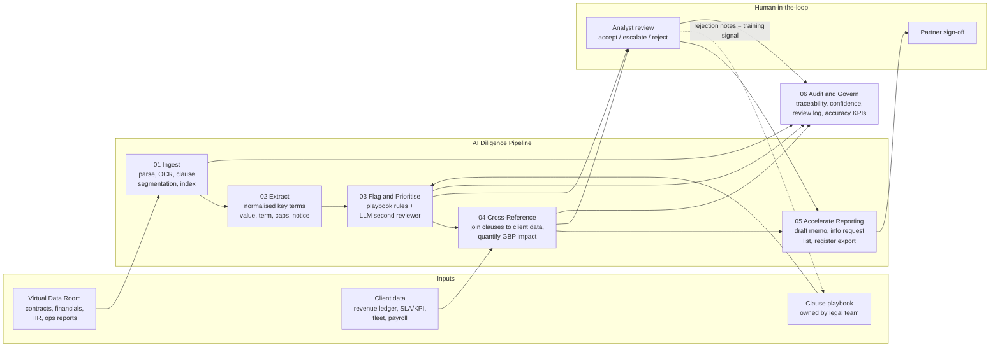
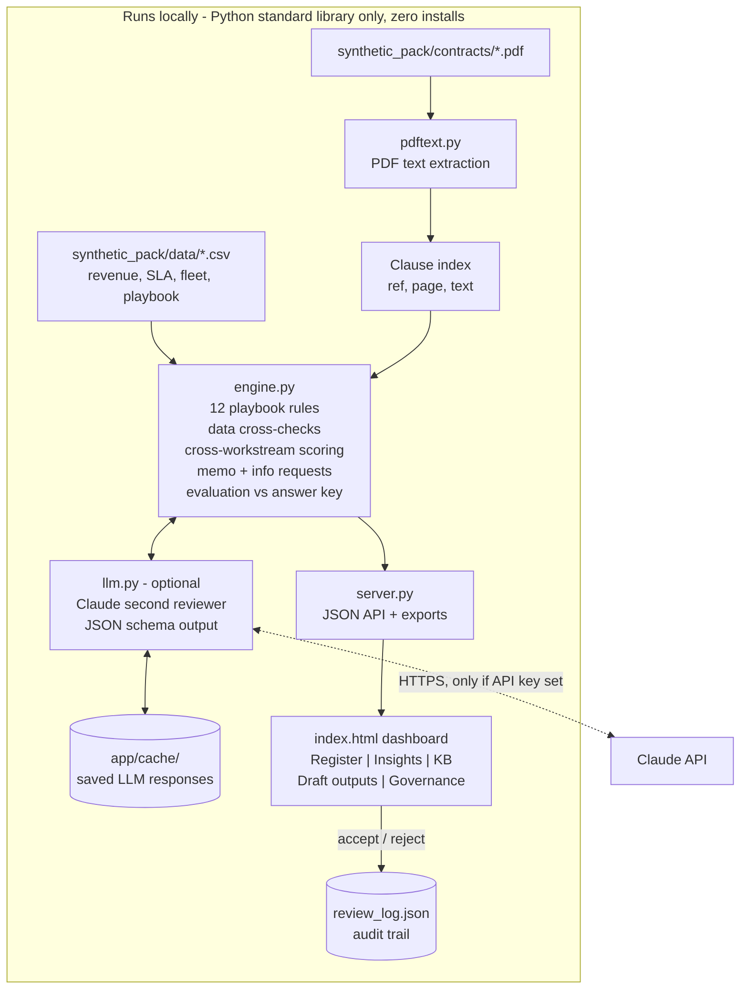
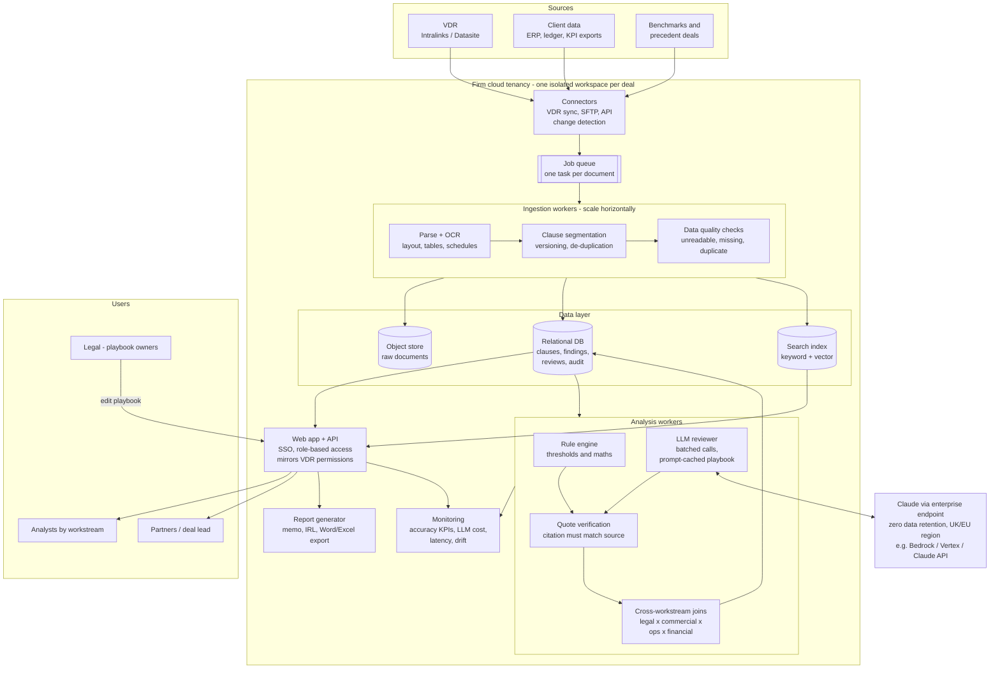
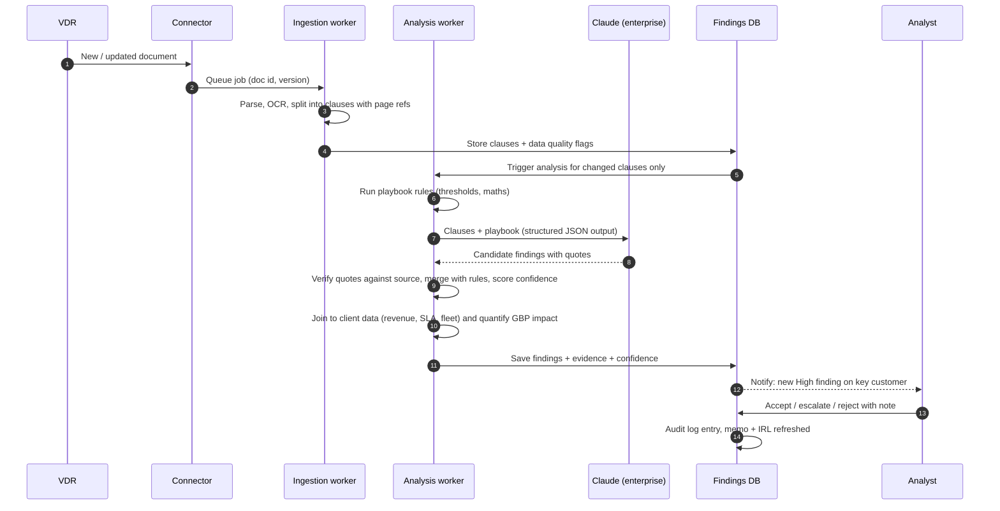
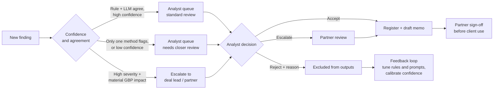
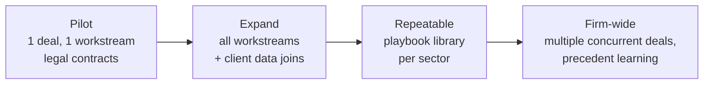
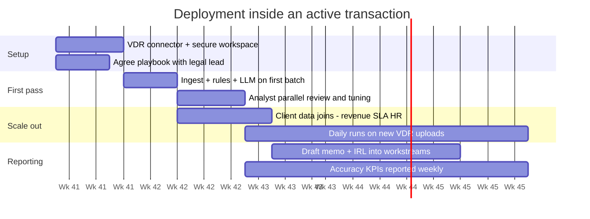

# AI Due Diligence Accelerator - Architecture

This covers two things:
1. **What the prototype does today** (this repo), and
2. **The proposed production architecture**: how the same design scales to a real deal with thousands of documents, several workstreams and many analysts.

The **logic stays the same** between the two (ingest → extract → flag → cross-reference → report → govern). Only the components get swapped for enterprise-grade versions.

> Diagrams use Mermaid and render automatically on GitHub.

---

## 1. End-to-end workflow (the six capabilities from the brief)

**Key design choices**
- **Push, not pull:** every clause is checked against every playbook rule, so findings don't depend on someone thinking to ask.
- **Lawyers own the playbook; the system applies it.** Analyst rejections feed back into improving it.
- **Nothing reaches a client-facing output without human review.**

---

## 2. Prototype architecture (this repo, as built)

| Prototype component | Purpose | Limitation |
|---|---|---|
| `pdftext.py` | Text from text-based PDFs | No OCR, tables or Word/Excel |
| Keyword rules | Repeatable, exact on thresholds | Tuned to this pack, so it overfits |
| Claude reviewer | Covers unseen wording | Not yet tested on new contracts |
| JSON files | Review log and LLM cache | Single user, no concurrency |
| Local web server | Zero-install demo | No auth, single machine |

---

## 3. Production architecture (proposed, scalable)

### What changes from prototype to production

| Concern | Prototype | Production |
|---|---|---|
| **Volume** | 6 PDFs | 1,000s of documents; queue + parallel workers |
| **Formats** | Text PDFs | OCR, Word, Excel, scanned, email |
| **Detection** | Keyword rules + optional LLM | Rules for thresholds/maths; LLM is primary for clause meaning; quote verification |
| **Incremental updates** | Re-run everything | Process only new or changed documents (change detection) |
| **Search** | Keyword over clauses | Hybrid keyword + vector index; Q&A with citations |
| **Storage** | JSON files | Relational DB + object store; full version history |
| **Users** | Single local user | SSO, role-based access per workstream, concurrency |
| **Confidentiality** | Runs on laptop | Isolated workspace per deal, no cross-deal data, zero-retention LLM |
| **Governance** | Review log + answer key | Audit DB, calibrated confidence, accuracy dashboard, escalation paths |
| **Cost control** | ~6 calls/run | Batch API, prompt caching, only re-review changed clauses |

---

## 4. How a new document flows through the system

**Effect on timelines:** a document uploaded in the morning has first-pass flags in minutes, not after it reaches the front of an analyst's reading queue. Risks show up while there's still negotiating leverage.

---

## 5. Human-in-the-loop and governance

**Controls**
- **Traceability:** every finding cites document, clause, page and a verbatim quote that has been checked against the source.
- **Confidence:** comes from rule strength, data corroboration and LLM agreement. It is calibrated over time from analyst decisions.
- **Accuracy KPIs:** recall and precision against seeded test issues and a clean control document, measured on every deal.
- **Confidentiality:** one workspace per deal, access mirrors VDR permissions, zero-retention LLM endpoint, no training on client data.

---

## 6. Scaling strategy

| Scale lever | How |
|---|---|
| **Throughput** | Stateless workers on a queue; add workers as document volume grows |
| **Latency** | Incremental processing: only new or changed clauses are re-analysed |
| **LLM cost** | Prompt caching of playbook and instructions; Batch API for overnight bulk runs; rules handle the mechanical checks for free |
| **Reuse across deals** | Sector playbooks (FM, healthcare, software...) maintained by legal; connectors reused |
| **Quality at scale** | Seed known test issues into every deal; track recall/precision; sample-audit accepted findings |
| **Multi-deal isolation** | Separate workspace per deal (storage, index, keys), so no data crosses information barriers |

---

## 7. Deployment plan within a live deal (4-8 weeks)

**Success metrics:** time from upload to first flag · analyst hours per contract · share of material risks found before SPA drafting · recall/precision on seeded issues · analyst rejection rate over time.
